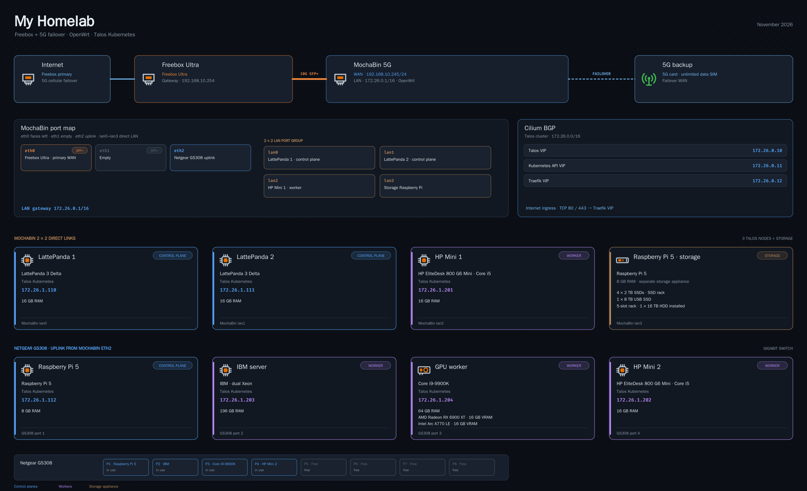

# homelab-diagram

This fork diagrams a Freebox Ultra, MochaBin 5G router, and Talos Kubernetes homelab. It turns `inventory.yaml` into an SVG and PNG.



> [!IMPORTANT]
> **This is not a general tool.** The *content* comes from `inventory.yaml`, but the *layout* (where every box, port and cable goes) is hand-placed in `build.py` for exactly my network. If you want to use it for yours, expect to move coordinates around in the code. Think of it as a starting point, not a finished product.

> [!NOTE]
> **The code was written by AI.** I built this together with Claude (Anthropic) in Claude Code. I described what I wanted and gave feedback on every render, Claude wrote and changed the code. A few example prompts are at the end of this README.

## What it shows

- Freebox primary WAN and MochaBin 5G failover, including the MochaBin port assignments
- the Netgear GS308 and its attached devices
- Talos control-plane and worker nodes with their assigned addresses
- Cilium BGP VIPs, Traefik ingress ports, and the separate Raspberry Pi storage appliance

## How it works

- `inventory.yaml` holds the topology, IP assignments, hardware, BGP VIPs, ingress ports, and storage devices.
- `build.py` draws the hand-placed layout as SVG, embeds the included glyph icons, and converts it to PNG with `rsvg-convert`.
- The diagram contains private network addresses and is not redacted. `python3 build.py --unredacted` writes a second copy with an `-unredacted` filename.

## Requirements

- Python 3 with **PyYAML** (Pillow is optional, but makes label widths exact)
- **rsvg-convert** (librsvg) for the PNG
- the fonts **Fira Sans** and **Fira Code** installed (found via fontconfig)

On Arch/CachyOS: `pacman -S python-yaml python-pillow librsvg ttf-fira-sans ttf-fira-code`
On Debian/Ubuntu: `apt install python3-yaml python3-pil librsvg2-bin fonts-firacode` plus Fira Sans

## Usage

```bash
python3 build.py                # → out/homelab.svg + out/homelab.png (private)
python3 build.py --unredacted   # → out/homelab-unredacted.svg + .png
```

The current diagram uses the local glyphs in `icons/`; service icon downloads are not required.

## Making it your own

1. Change `inventory.yaml` to your network.
2. Update the hand-placed positions in `build.py` when adding or moving devices. The main sections are the internet edge, MochaBin port map, BGP/VIP panel, node rows, and switch port map.
3. Use the included `icons/glyph-*.svg` icons or add another SVG under `icons/`.

## Using it with Claude Code

The repo contains a [`CLAUDE.md`](CLAUDE.md) with everything an AI agent needs to adapt it to your lab: how the code is structured, which parts of the layout are hardcoded, the questions to ask about your network, the render-and-check loop, and the design rules this diagram follows.

Clone the repo, open it with [Claude Code](https://claude.com/claude-code) and say something like *"help me make this diagram for my homelab"*. It will interview you about your network (or read your docs if you have some), rewrite `inventory.yaml`, adapt `build.py` and iterate on the render with you. Other agents can use the same file as context.

## How it was made

I had seen these diagrams on r/homelab for years and always wanted one for my own network. My setup was documented in an Obsidian vault (written by another Claude Code session, checked against the live systems), so the workflow was:

1. **Gathering the facts.** Claude Code read the documentation and filled the gaps with read-only checks on the live systems: link speeds from the switch, disk models and pool usage from TrueNAS, the router model from its info page, hostnames from DNS, the containers running in each CT.
2. **First draft.** Claude wrote `inventory.yaml` and `build.py`, rendered the PNG and looked at the image itself (plus zoomed-in crops) to catch overlaps before showing it to me.
3. **Iterating.** Then it was me giving feedback, Claude changing the code, re-rendering and checking again, about 60 rounds. Most of the design decisions (folder-shaped device cards, line width = speed, CT on top and IP below, no internal ports, …) came out of that back and forth.
4. **Publishing.** For this repo Claude made a cleaned-up copy (example domain, generic SSIDs), added the icon download script and checked that a fresh clone renders exactly the posted image.

Tools: Claude Code with Claude Opus 5.5, Python, librsvg, Pillow.

## Example prompts

About 60 prompts went into this. Three typical ones, to give an idea of how the back and forth looked:

**Getting started**
> Do you know the network diagrams people post on r/homelab? I'd like one for my own network. My setup is documented in my Obsidian vault, read it and check the live systems for anything that's missing.

**Design feedback**
> Use the line thickness to show the link speed and put a small speed label where each cable reaches a device. Also remove the interface names like em0 or igc0, nobody needs them on a diagram.

**Fixing the facts**
> That's not quite right yet: there are two shares. qBittorrent only downloads into the Torrents share, and when a download is done Sonarr/Radarr copy the file with the right name into the Media share. qBittorrent has no access to the Media share at all.

## Credits & license

- Code and the glyph icons in `icons/`: MIT, see [LICENSE](LICENSE).
- Service icons: [homarr-labs/dashboard-icons](https://github.com/homarr-labs/dashboard-icons), downloaded by `fetch_icons.py`, not part of this repo. The logos belong to their projects.
- Fonts: [Fira Sans / Fira Code](https://github.com/mozilla/Fira) (SIL Open Font License), not included.
